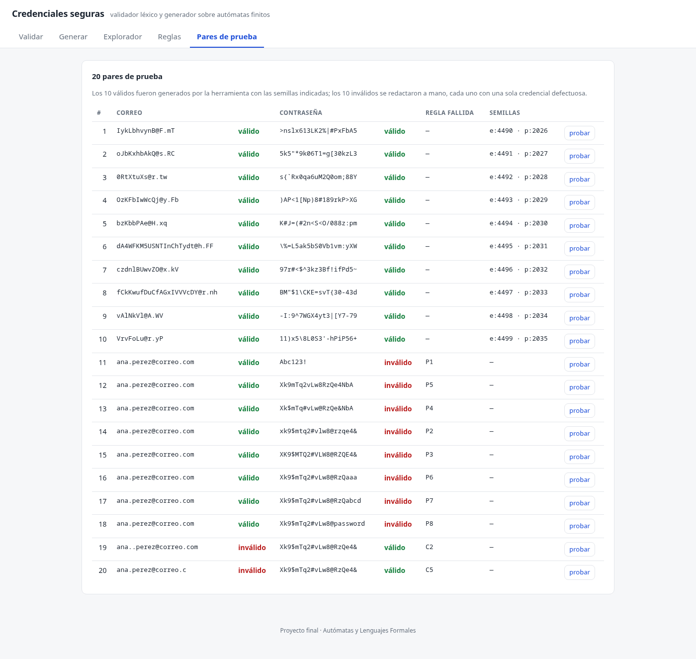
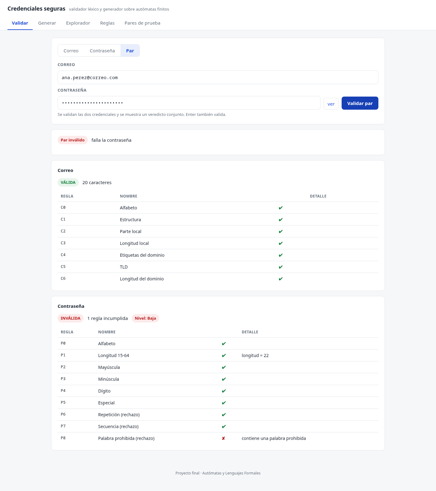
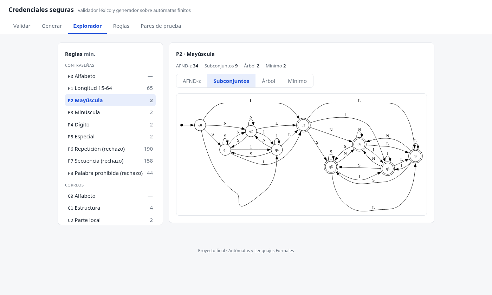
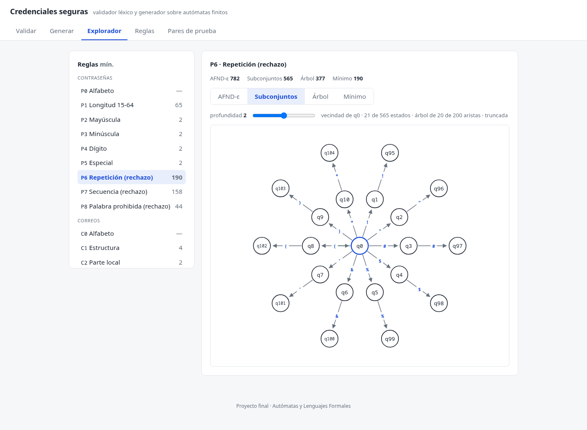
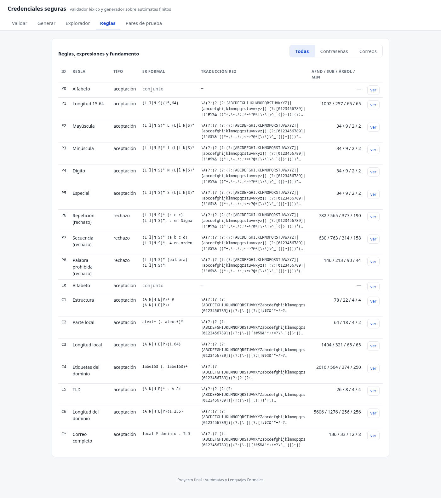

# Sistema de generación y validador léxico de credenciales seguras

**Curso:** Autómatas y Lenguajes Formales
**Catedrática:** Lcda. Mildred Veronica Palacios Martinez
**Universidad Mariano Gálvez de Guatemala — Campus Huehuetenango**
**Facultad de Ingeniería en Sistema**
**Integrantes:** Cristian Antonio Mendoza Mendoza (4490-24-10243), Freidh Yannel Morales
<!-- TODO: carné -->, Walter Emanuel Figueroa Vásquez <!-- TODO: carné -->
**Fecha:** <!-- TODO: fecha de entrega -->

---

## Resumen

Este trabajo implementa un validador y un generador de credenciales construidos sobre
autómatas finitos. El validador decide si un correo electrónico y una contraseña cumplen
un conjunto de reglas derivadas de NIST SP 800-63B, del CIS Password Policy Guide y del
RFC 5322, e informa **cuál regla exacta** falla cuando la credencial es rechazada. El
generador no sortea cadenas al azar hasta que una pase: construye el autómata producto de
las cinco reglas de aceptación de contraseñas sobre sus AFD minimizados, y camina sobre él
tomando únicamente transiciones desde las que todavía es posible terminar en un estado de
aceptación. El resultado es determinista para una semilla dada y se puede reproducir paso
por paso.

Las 17 reglas se declaran como expresiones regulares —o como verificaciones de conjunto,
en el caso de P0 y C0—, se convierten a un AFND-ε por el método de Thompson, se determinan
por subconjuntos, se contrastan con el método del árbol y se minimizan por el algoritmo de
Moore. La implementación en Go se verificó contra dos oráculos independientes: la
biblioteca RE2 y el prototipo en Python del primer avance. Ambos coinciden en el 100 % de
los casos.

---

## 1. Introducción y objetivo

Una credencial es un par (correo, contraseña). Validarla suele resolverse con una lista de
condiciones dispersas en el código: `len(s) >= 15`, `strings.ContainsAny(s, "!@#")`,
`regexp.MatchString(...)`. Ese enfoque funciona, pero no responde la pregunta que interesa
en un curso de lenguajes formales: **¿qué lenguaje acepta el sistema?**

Este proyecto responde esa pregunta de forma explícita. Cada regla de forma es una
expresión regular sobre un alfabeto declarado; cada expresión se compila a un autómata
finito determinista mínimo; y tanto la validación como la generación operan sobre esos
autómatas, no sobre condicionales ad hoc. De ahí se obtienen tres propiedades que el
trabajo demuestra y mide:

1. **Trazabilidad.** Cuando una contraseña es rechazada, el reporte nombra la regla y el
   autómata que la rechazó, no un mensaje genérico.
2. **Corrección verificable.** El mismo lenguaje se construye por dos métodos distintos
   (subconjuntos y árbol) y se comprueba su equivalencia; además se contrasta contra una
   implementación independiente.
3. **Generación dirigida.** Las credenciales válidas se obtienen caminando el autómata
   producto, lo que garantiza por construcción que la cadena pertenece al lenguaje.

El objetivo del documento es presentar el método, los resultados medidos y la aplicación
que los expone. Los pasos 1 a 4 del método (alfabetos, expresiones, gramáticas, Thompson,
árbol y minimización) están desarrollados con tablas de estados en el primer avance; este
documento los resume y se concentra en los pasos 5 y 6: la construcción del producto, la
caminata guiada y la verificación.

---

## 2. Marco normativo

### 2.1 NIST SP 800-63B

La guía de identidad digital del NIST (SP 800-63B, Revisión 4, 2025) fija qué debe exigir
un sistema de autenticación y, sobre todo, qué **no** debe exigir. Los puntos que este
trabajo adopta:

- Longitud mínima de 15 caracteres para autenticadores de un solo factor.
- Longitud máxima de al menos 64 caracteres, sin truncar la entrada.
- Comparación contra una lista de contraseñas prohibidas (blocklist).
- Rechazo de repeticiones y secuencias triviales.
- Prohibición de reglas de composición obligatorias y de rotación periódica sin indicio
  de compromiso.

La última prohibición es la que obliga a pensar el problema con cuidado: el estándar no
quiere exigir "una mayúscula, un dígito y un símbolo". Sin embargo, el enunciado del curso
pide evaluar esas clases por separado para poder mostrar el autómata de cada una. La
solución adoptada es tratar P2, P3, P4 y P5 como **reglas de reporte**: se evalúan y se
informan, y su cumplimiento se exige en el perfil del curso, pero el diseño deja claro que
son políticas configurables y no requisitos del NIST.

### 2.2 CIS Password Policy Guide

El CIS no compite con NIST: lo traduce a valores operativos. De ahí se toman los umbrales
de longitud y la lista de palabras prohibidas que alimenta P8. El historial de contraseñas
y el bloqueo de cuenta que el CIS también recomienda son políticas de servidor con estado,
fuera del alcance de un validador léxico, y por eso no se implementan.

### 2.3 RFC 5322

El correo se valida contra un subconjunto del RFC 5322: parte local con `atext` y puntos
internos, arroba única, etiquetas de dominio separadas por punto, y un TLD alfabético de al
menos dos letras. El subconjunto excluye comentarios, direcciones entre comillas y
literales de dominio, que el RFC permite pero que no aportan al ejercicio y multiplican el
autómata sin cambiar el método.

### 2.4 Traducción a reglas

| Fuente | Regla del sistema |
|---|---|
| NIST 800-63B Rev. 4 (longitud mínima) | P1: entre 15 y 64 caracteres |
| NIST 800-63B (complejidad) | P2-P5: mayúscula, minúscula, dígito y especial |
| NIST 800-63B (repeticiones) | P6: tres caracteres idénticos consecutivos |
| NIST 800-63B (secuencias) | P7: cuatro caracteres en orden ascendente o descendente |
| NIST + CIS (blocklist) | P8: palabra prohibida |
| RFC 5322 §3.2.3 (atext) | C1-C2: estructura y parte local |
| RFC 5322 §3.4.1 (dominio) | C4-C5: etiquetas y TLD |
| RFC 5321 §4.5.3.1 y RFC 1035 §2.3.4 (longitudes) | C3, C4 y C6: 64, 63 y 255 octetos |

---

## 3. El lenguaje: alfabetos y reglas

### 3.1 Alfabeto de contraseñas

Σ<sub>P</sub> son los 94 símbolos ASCII imprimibles (0x21 a 0x7E). El espacio (0x20) se
elimina antes de validar, de modo que no forma parte del alfabeto: una contraseña con
espacios se evalúa como si no los tuviera. Sobre Σ<sub>P</sub> se definen cuatro clases:

| Etiqueta | Clase | Cardinalidad |
|---|---|---:|
| `L` | mayúsculas `A-Z` | 26 |
| `l` | minúsculas `a-z` | 26 |
| `N` | dígitos `0-9` | 10 |
| `S` | especiales (Σ<sub>P</sub> menos L, l y N) | 32 |

La regla P0 verifica que todos los símbolos pertenezcan a Σ<sub>P</sub>. Es una
verificación de conjunto, no un autómata: si falla, las demás reglas no se evalúan.

### 3.2 Alfabeto de correos

Σ<sub>C</sub> es el conjunto de caracteres que pueden aparecer en una dirección del
subconjunto adoptado, con etiquetas propias para el guion (`H`), el punto (`P`), la arroba
(`E`) y el resto de `atext` (`A`), más los dígitos (`N`). La distinción entre `A` y `H` es
necesaria porque el guion no puede abrir ni cerrar una etiqueta de dominio.

### 3.3 Las 17 reglas

`P0` y `C0` son verificaciones de conjunto y no tienen autómata. Las 15 restantes se
construyen en tiempo de ejecución.

| ID | Nombre | Tipo | Expresión regular |
|---|---|---|---|
| P0 | Alfabeto | conjunto | — |
| P1 | Longitud 15-64 | acepta | `(L\|l\|N\|S){15,64}` |
| P2 | Mayúscula | acepta | `(L\|l\|N\|S)* L (L\|l\|N\|S)*` |
| P3 | Minúscula | acepta | `(L\|l\|N\|S)* l (L\|l\|N\|S)*` |
| P4 | Dígito | acepta | `(L\|l\|N\|S)* N (L\|l\|N\|S)*` |
| P5 | Especial | acepta | `(L\|l\|N\|S)* S (L\|l\|N\|S)*` |
| P6 | Repetición | rechaza | `(L\|l\|N\|S)* (c c c) (L\|l\|N\|S)*`, c ∈ Σ<sub>P</sub> |
| P7 | Secuencia | rechaza | `(L\|l\|N\|S)* (a b c d) (L\|l\|N\|S)*`, cuatro en orden |
| P8 | Palabra prohibida | rechaza | `(L\|l\|N\|S)* (palabra) (L\|l\|N\|S)*` |
| C0 | Alfabeto | conjunto | — |
| C1 | Estructura | acepta | `(A\|N\|H\|E\|P)+ @ (A\|N\|H\|E\|P)+` |
| C2 | Parte local | acepta | `atext+ (. atext+)*` |
| C3 | Longitud local | acepta | `(A\|N\|H\|E\|P){1,64}` |
| C4 | Etiquetas del dominio | acepta | `label63 (. label63)+` |
| C5 | TLD | acepta | `(A\|N\|H\|P)* . A A+` |
| C6 | Longitud del dominio | acepta | `(A\|N\|H\|E\|P){1,255}` |
| C\* | Correo completo | acepta | `local @ dominio . TLD` |

Las reglas P6, P7 y P8 describen el **caso malo**: su autómata acepta las cadenas que
deben rechazarse. Por eso el veredicto de esas tres se invierte al construir el reporte.
Este diseño es deliberado: permite que las tres se construyan con el mismo motor que las
demás, sin un operador de complemento, y que la traza muestre exactamente qué subcadena
disparó el rechazo.

---

## 4. Del ER al AFD

### 4.1 Thompson

Cada expresión se compila a un AFND-ε con el método de Thompson, usando cinco
construcciones: símbolo, concatenación, alternancia, estrella y repetición acotada
(`{m,n}` se expande a `m` copias seguidas de `n-m` copias opcionales). El orden de
asignación de estados es fijo, de modo que dos ejecuciones producen el mismo autómata y
las tablas del documento coinciden con las del programa.

### 4.2 Subconjuntos

La determinación por subconjuntos produce un AFD cuyos estados son conjuntos de estados
del AFND. El AFD es **parcial**: las transiciones que llevarían al conjunto vacío se
omiten en lugar de apuntar a un estado muerto. Esa decisión explica el conteo de P1: el
AFD mínimo tiene 65 estados en lugar de 66, porque la clase muerta se elimina.

### 4.3 Método del árbol

Como verificación independiente, cada expresión se convierte también con el método del
árbol: se construye el árbol de sintaxis, se calculan `nullable`, `firstpos`, `lastpos` y
`followpos`, y de ahí sale un AFD directamente. Los dos AFD deben aceptar el mismo
lenguaje; el programa lo comprueba con una relación de equivalencia sobre el producto de
ambos, no con una muestra de cadenas.

### 4.4 Minimización de Moore

El AFD del método del árbol se minimiza refinando particiones: se separan aceptación de no
aceptación y se refina mientras dos estados del mismo bloque difieran en el bloque destino
para algún símbolo. El resultado se renumera por recorrido en anchura desde el estado
inicial, de modo que la numeración es canónica y estable.

### 4.5 Conteos

Los cuatro conteos por regla, medidos en ejecución:

| Regla | AFND-ε | Subconjuntos | Árbol | Mínimo |
|---|---:|---:|---:|---:|
| P1 | 1092 | 257 | 65 | 65 |
| P2 | 34 | 9 | 2 | 2 |
| P3 | 34 | 9 | 2 | 2 |
| P4 | 34 | 9 | 2 | 2 |
| P5 | 34 | 9 | 2 | 2 |
| P6 | 782 | 565 | 377 | 190 |
| P7 | 630 | 763 | 314 | 158 |
| P8 | 146 | 213 | 90 | 44 |
| C1 | 78 | 22 | 4 | 4 |
| C2 | 64 | 18 | 4 | 2 |
| C3 | 1404 | 321 | 65 | 65 |
| C4 | 2616 | 564 | 374 | 250 |
| C5 | 26 | 8 | 4 | 4 |
| C6 | 5606 | 1276 | 256 | 256 |
| C\* | 136 | 33 | 12 | 8 |

P3, P4 y P5 son idénticas a P2 por construcción: la única diferencia es la clase del
símbolo obligatorio, y el alfabeto es el mismo. El mínimo nunca supera al árbol, y en C2,
C\* y otras reglas es estrictamente menor, lo que confirma que la minimización elimina
estados distinguibles por el autómata del árbol pero no por el lenguaje.

El autómata de las 24 permutaciones (`COMP`) queda documentado en el primer avance y no se
construye en tiempo de ejecución: su tamaño no aporta al método y multiplicaría el costo de
arranque.

---

## 5. Verificación de la implementación

Ninguna de las afirmaciones anteriores se apoya en inspección visual. Hay tres controles
automáticos: dos corren en `make check` y el tercero en `make check-oracle`.

### 5.1 Equivalencia interna

Para cada una de las 15 reglas, el programa comprueba que el AFD por subconjuntos, el AFD
del árbol y el AFD mínimo aceptan el mismo lenguaje. La comprobación se hace sobre el
producto de los autómatas: si existe un par de estados alcanzable donde uno acepta y el otro
no, los lenguajes difieren. No es una muestra: es una decisión.

### 5.2 Oráculo RE2

Cada expresión se traduce a sintaxis RE2 y se compara con el autómata sobre **1500 cadenas
por regla**: la mitad son mutaciones de una cadena válida, que alcanzan las fronteras de
longitud y de clase, y la otra mitad son cadenas aleatorias. Total: **22 500
comparaciones, 0 discrepancias**. Este oráculo es el que detecta errores de traducción: si
la expresión que se muestra en pantalla no es la que el autómata implementa, RE2 y el
autómata discrepan en alguna cadena.

### 5.3 Diferencial contra el prototipo

El primer avance se implementó en Python. Ese prototipo se conserva en `codigo_avance/` y
se usa como segundo oráculo: se construyen las 15 reglas en ambos lenguajes, se comparan
los cuatro conteos y se evalúan **6000 cadenas** (400 por regla). Resultado: los mismos
conteos y el mismo veredicto en todas. Este control es el que valida el puerto a Go: un
error de índices o de orden de estados aparecería como un conteo distinto.

---

## 6. Validación en la aplicación

### 6.1 Reporte por regla

`POST /api/validar` devuelve, para cada regla, su identificador, si se evaluó, si pasó y un
mensaje en español. Las reglas que no se evalúan aparecen como omitidas en lugar de
desaparecer: si P0 falla porque hay un carácter fuera del alfabeto, el reporte muestra las
nueve reglas de contraseña, con P1 a P8 marcadas como omitidas. Así el usuario ve el
conjunto completo y entiende por qué se detuvo la evaluación.

### 6.2 Nivel de seguridad

El nivel sigue el Anexo C del enunciado. Solo se calcula para contraseñas válidas:

| Longitud | Nivel | Entropía estimada |
|---|---|---|
| 15-19 | Media | n · log₂ 94 |
| 20-64 | Fuerte | n · log₂ 94 |
| inválida o con filtro de rechazo | Baja | no se reporta |

La entropía es una estimación bruta de n · log₂ 94 bits (≈ 6.55 bits por carácter), la
misma fórmula del anexo. Para la contraseña de demostración, 20 caracteres, son 131 bits.
El caso límite está probado: una contraseña de 20 caracteres que contiene una palabra
prohibida es **Baja**, no Fuerte, porque el nivel se calcula después de los filtros.

### 6.3 Fronteras y normalización

| Caso | Valores probados | Resultado esperado |
|---|---|---|
| Longitud de contraseña | 14 / 15 / 16 y 64 / 65 | 14 y 65 rechazadas; 15, 16 y 64 aceptadas |
| Nivel | 19 / 20 | Media / Fuerte |
| Etiqueta de dominio | 63 / 64 | 63 aceptada; 64 rechazada |
| Parte local | 64 / 65 | 64 aceptada; 65 rechazada |
| Dominio completo | 255 / 256 | 255 aceptado; 256 rechazado |
| Espacios | ambos tipos | se eliminan antes de validar |
| Blocklist | palabra prohibida en cadena larga | Baja |

Los tres límites de longitud del correo no salen del RFC 5322, que no los fija: el de 64 en
la parte local y el de 255 en el dominio vienen del RFC 5321, y el de 63 por etiqueta, del
RFC 1035. Por eso C3, C4 y C6 los declaran explícitamente en lugar de darlos por supuestos.

---

## 7. Generación guiada por el autómata

### 7.1 El producto P1 × P2 × P3 × P4 × P5

Generar una contraseña válida exige satisfacer cinco reglas a la vez. La forma correcta de
hacerlo es construir el autómata producto de las cinco: un estado del producto es una
quinta (q₁, q₂, q₃, q₄, q₅) de estados de los AFD minimizados, y una transición existe
cuando las cinco componentes pueden tomarla con el mismo símbolo.

El tamaño teórico es el producto de los tamaños, 65 × 2 × 2 × 2 × 2 = 1040 estados. El
producto **alcanzable** desde el estado inicial tiene **944**: los 65 estados de P1
aparecen todos, pero no con las 16 combinaciones de P2-P5. Con menos de cuatro símbolos no
todas las clases pueden haber aparecido (1, 4, 10 y 14 combinaciones para 0, 1, 2 y 3
caracteres leídos), y aun con cuatro o más queda una combinación que ninguna cadena
produce: la de las cuatro clases sin aparecer. El programa construye el producto sobre los
AFD **minimizados**, no sobre los de subconjuntos; hacerlo sobre estos últimos daría
257 × 9⁴ ≈ 1.69 millones de estados, inviable.

El alfabeto del producto se toma de P1, cuyas cuatro clases (L, l, N, S) cubren Σ<sub>P</sub>
sin solaparse. Cada transición del producto es, entonces, una transición por clase, y el
símbolo concreto se elige después dentro de la clase.

### 7.2 La caminata

El algoritmo no sortea cadenas. Antes de caminar se calcula, para cada estado y cada número
de pasos restantes, si desde ahí se puede llegar a un estado de aceptación en exactamente
ese número de pasos (`reach[estado][restantes]`). Es una programación dinámica sobre el
producto, de tamaño 944 × 65.

Con esa tabla, la caminata es:

1. Empezar en el estado inicial, con `n` pasos por delante.
2. En cada paso, considerar solo las clases cuya transición lleve a un estado desde el que
   se pueda aceptar en los pasos restantes.
3. Elegir una clase al azar **uniformemente entre las viables**, y un símbolo al azar dentro
   de la clase.
4. Repetir hasta consumir los `n` pasos.

La propiedad que garantiza el método es que la caminata **nunca se atasca**: en cada paso
existe al menos una clase viable, porque el estado actual se alcanzó desde una transición
que preservaba la alcanzabilidad. Al final, el estado es de aceptación por construcción.

Esto es lo que distingue al generador de un `random.choice` sobre el alfabeto seguido de un
filtro: la probabilidad de producir una cadena válida por sorteo es ínfima para 20
caracteres con cinco reglas simultáneas, mientras que la caminata produce una cadena que el
producto acepta en el primer intento, y solo la descarta si después la atrapa un filtro de
rechazo.

### 7.3 Filtros de rechazo

Las reglas P6, P7 y P8 no forman parte del producto: son filtros de rechazo, y su autómata
acepta el caso malo. Añadirlos al producto exigiría complementarlos, lo que multiplicaría
el tamaño sin mejorar el método. En su lugar, la candidata que produce la caminata se
evalúa contra los tres filtros; si alguno la acepta (es decir, si contiene una repetición,
una secuencia o una palabra prohibida), se descarta y se vuelve a caminar con el **mismo**
generador pseudoaleatorio, que continúa su secuencia.

El límite es de 200 intentos; en las pruebas de propiedad el límite no se alcanza nunca.
El generador de correos usa la misma idea sobre el AFD mínimo de C\*, con un detalle
importante: una caminata uniforme sobre C\* casi nunca encuentra la arroba, porque hay
muchas más transiciones que la evitan. La guía por alcanzabilidad es la que fuerza a que la
parte local, la arroba, las etiquetas y el TLD aparezcan en orden.

### 7.4 Determinismo

Toda la aleatoriedad pasa por un único `rand.New(rand.NewSource(semilla))`. No se usa el
generador global del paquete `rand`, no se itera sobre mapas para construir estructuras y
todas las listas se ordenan antes de usarse. Consecuencias medibles:

- La misma semilla produce la misma contraseña **y el mismo camino** (la lista de estados
  visitados), en la misma ejecución y tras reiniciar el proceso.
- La semilla 2026 con longitud 20 produce siempre `>nslx613LK2%|#PxFbA5`, nivel Fuerte,
  131 bits.
- La semilla 4490 produce siempre el correo `IykLbhvynB@F.mT`.
- Los 10 pares válidos de la entrega se regeneran byte a byte desde sus semillas.


*Figura 1. Generar con la semilla 2026 y longitud 20. La misma semilla reproduce el mismo
valor y la misma secuencia de estados; el camino lista cada paso con su estado y la clase
del símbolo consumido.*

### 7.5 Propiedad del generador

Se generaron **1000 contraseñas** con longitudes entre 15 y 64 y **300 correos**; el 100 %
fue aceptado por el validador. La misma semilla se ejecuta dos veces dentro del proceso
para comparar valor y camino, y los 20 pares se regeneran byte a byte desde un archivo
construido en una ejecución anterior: eso cubre la comprobación entre reinicios, porque el
generador no guarda estado global.

---

## 8. Los 20 pares de prueba

La entrega incluye diez pares válidos, generados por la herramienta, y diez inválidos, cada
uno con exactamente una credencial defectuosa. Las tablas se generan desde
`testdata/pares.json` con `make pares-tabla`, que escribe `pares.md`; las de este capítulo
son una copia de ese fragmento, y una prueba falla si `pares.md` se desincroniza del JSON.

### Pares válidos

Los diez pares válidos los generó la herramienta caminando el autómata producto. Las semillas quedan registradas, así que `make pairs` los reproduce byte a byte.

| # | Correo | Contraseña | Semillas (correo / contraseña) |
|---:|---|---|---|
| 1 | `IykLbhvynB@F.mT` | `>nslx613LK2%\|#PxFbA5` | 4490 / 2026 |
| 2 | `oJbKxhbAkQ@s.RC` | `5k5"*9k06T1=g[30kzL3` | 4491 / 2027 |
| 3 | `0RtXtuXs@r.tw` | ``s{`Rx0qa6uM2Q0om;88Y`` | 4492 / 2028 |
| 4 | `OzKFbIwWcQj@y.Fb` | `)AP<1[Np)8#189rkP>XG` | 4493 / 2029 |
| 5 | `bzKbbPAe@H.xq` | `K#J=(#2n<S<O/088z:pm` | 4494 / 2030 |
| 6 | `dA4WFKM5USNTInChTydt@h.FF` | `\%=L5ak5bS0Vb1vm:yXW` | 4495 / 2031 |
| 7 | `czdnlBUwvZO@x.kV` | `97r#<$^3kz3Bf!ifPd5~` | 4496 / 2032 |
| 8 | `fCkKwufDuCfAGxIVVVcDY@r.nh` | `BM"$1\CKE=svT{30-43d` | 4497 / 2033 |
| 9 | `vAlNkVl@A.WV` | `-I:9^7WGX4yt3\|[Y7-79` | 4498 / 2034 |
| 10 | `VrvFoLu@r.yP` | `11)x5\8L0S3'-hPiP56+` | 4499 / 2035 |

### Pares inválidos

Cada fila tiene exactamente una credencial defectuosa y nombra la regla que la rechaza; la otra mitad del par es válida.

| # | Correo | Contraseña | Qué falla |
|---:|---|---|---|
| 11 | `ana.perez@correo.com` | `Abc123!` | contraseña · **P1** Longitud 15-64 |
| 12 | `ana.perez@correo.com` | `Xk9mTq2vLw8RzQe4NbA` | contraseña · **P5** Especial |
| 13 | `ana.perez@correo.com` | `Xk$mTq#vLw@RzQe&NbA` | contraseña · **P4** Dígito |
| 14 | `ana.perez@correo.com` | `xk9$mtq2#vlw8@rzqe4&` | contraseña · **P2** Mayúscula |
| 15 | `ana.perez@correo.com` | `XK9$MTQ2#VLW8@RZQE4&` | contraseña · **P3** Minúscula |
| 16 | `ana.perez@correo.com` | `Xk9$mTq2#vLw8@RzQaaa` | contraseña · **P6** Repetición (rechazo) |
| 17 | `ana.perez@correo.com` | `Xk9$mTq2#vLw8@RzQabcd` | contraseña · **P7** Secuencia (rechazo) |
| 18 | `ana.perez@correo.com` | `Xk9$mTq2#vLw8@password` | contraseña · **P8** Palabra prohibida (rechazo) |
| 19 | `ana..perez@correo.com` | `Xk9$mTq2#vLw8@RzQe4&` | correo · **C2** Parte local |
| 20 | `ana.perez@correo.c` | `Xk9$mTq2#vLw8@RzQe4&` | correo · **C5** TLD |



*Figura 2. Los 20 pares de la entrega. Las columnas de veredicto muestran el resultado del
validador para cada mitad, y las semillas permiten regenerar los diez pares válidos.*

### Cómo se regeneran

```sh
make pairs        # reescribe testdata/pares.json desde las semillas registradas
make pares-tabla  # reescribe las tablas de este capítulo
```

La prueba `TestPairsRegenerate` falla si el archivo no se reproduce byte a byte, y
`TestPairsVerdicts` falla si algún veredicto o alguna regla nombrada deja de coincidir con
el validador.

---

## 9. La aplicación

### 9.1 Arquitectura

Un único binario en Go, sin dependencias externas, que sirve su propio frontend embebido
con `//go:embed`. El frontend es HTML, CSS y JavaScript sin paso de compilación.

| Paquete | Responsabilidad |
|---|---|
| `internal/automata` | AST, Thompson, subconjuntos, árbol, Moore, simulación, DOT, traducción a RE2 |
| `internal/rules` | las 17 reglas, sus alfabetos, etiquetas y expresiones |
| `internal/validate` | reporte por regla, normalización, nivel y entropía |
| `internal/generate` | producto P1-P5, caminata guiada, generación de correos |
| `internal/api` | los endpoints y el contrato JSON |
| `web/` | las cinco pantallas |

`internal/automata` no importa nada del proyecto y no conoce la interfaz: recibe un árbol de
sintaxis y devuelve autómatas. Esa separación es lo que permite usarlo como motor genérico y
probarlo con sus propios casos.

### 9.2 Pantallas

| Pantalla | Qué muestra |
|---|---|
| Validar | reporte por regla de un correo, una contraseña o un par completo, con nivel y entropía |
| Generar | credencial generada desde una semilla, con el camino recorrido sobre el producto |
| Explorador | las cuatro vistas del autómata (AFND, subconjuntos, árbol, mínimo), la tabla de transiciones, la simulación con traza y una vecindad navegable para las vistas grandes |
| Reglas | las 17 reglas con su expresión, su traducción a RE2 y sus conteos |
| Pares | los 20 pares de la entrega con su veredicto |



*Figura 3. Validar en modo par. El correo pasa sus siete reglas y queda en verde; la
contraseña contiene una palabra prohibida, P8 la marca en rojo con el mensaje que nombra el
motivo, y el nivel baja a Baja. El par es inválido porque basta que falle una de las dos
mitades.*



*Figura 4. Explorador sobre P2. La cabecera resume los cuatro conteos —34 en el AFND-ε, 9
por subconjuntos, 2 en el árbol y 2 en el mínimo— y el grafo dibuja el AFD por subconjuntos,
que es la vista seleccionada. La tabla de transiciones y el simulador quedan debajo, en la
misma pantalla.*



*Figura 5. Vecindad navegable. Cuando la vista supera el umbral de dibujo, el explorador
muestra solo la vecindad del estado elegido hasta la profundidad indicada: 21 de los 565
estados de P6 por subconjuntos, y 20 de sus 200 aristas. Un clic en cualquier nodo lo vuelve
centro.*



*Figura 6. Pantalla de reglas, con las 17 en una sola vista. La traducción a RE2 de P1 se
muestra recortada a tres líneas porque la repetición `{15,64}` se expande a miles de
caracteres; un clic en la celda la despliega completa.*

### 9.3 Contrato de la API

| Método | Ruta | Función |
|---|---|---|
| GET | `/api/salud` | estado del servicio |
| POST | `/api/validar` | reporte de un correo o una contraseña |
| POST | `/api/generar` | credencial desde una semilla |
| GET | `/api/reglas` | las 17 reglas con expresión, RE2 y conteos |
| GET | `/api/automatas/{id}` | vista del autómata, transiciones paginadas y vecindad |
| POST | `/api/simular` | traza de una cadena sobre un autómata |
| GET | `/api/pares` | los 20 pares de prueba |

El contrato completo, con los cuerpos de cada petición y respuesta, está en `docs/api.md`.

---

## 10. Pruebas y puerta de calidad

`make check` es la única puerta: comprueba el formato con `gofmt -l` (debe estar vacío),
ejecuta `go vet` y corre todas las pruebas. Es no interactiva y solo cubre Go, de modo que
no depende de tener Python ni Graphviz instalados. `make check-oracle` añade el diferencial
en Python y no es necesario para ejecutar la aplicación.

| Control | Alcance | Resultado |
|---|---|---|
| Equivalencia de autómatas | 15 reglas | 0 diferencias |
| Oráculo RE2 | 22 500 comparaciones | 0 discrepancias |
| Diferencial Python | 15 reglas, 6000 cadenas | mismos conteos y veredictos |
| Generador | 1000 contraseñas + 300 correos | 100 % válidas, deterministas |
| Pares | 20 pares | 20 veredictos correctos, regeneración byte a byte |
| Fronteras | longitudes, niveles, etiquetas, dominios | todos los casos de la sección 6.3 |

---

## 11. Conclusiones

1. **El lenguaje se puede declarar.** Las 15 reglas de forma caben en expresiones regulares
   sobre alfabetos explícitos, y las dos de alfabeto se reducen a una verificación de
   conjunto. Esa declaración es ejecutable: el mismo texto que se muestra en pantalla es el
   que se compila.
2. **Construir dos veces sirve.** El método del árbol y el de subconjuntos producen
   autómatas distintos del mismo lenguaje; comprobar su equivalencia detecta errores que
   una batería de cadenas no detectaría.
3. **La minimización no es cosmética.** Sobre los AFD de subconjuntos el producto tendría
   1.69 millones de estados; sobre los mínimos son 1040 teóricos y 944 alcanzables. Además
   reduce el autómata de C\* de 12 a 8 estados.
4. **Generar es caminar, no sortear.** La tabla de alcanzabilidad convierte la generación en
   una caminata dirigida que no puede atascarse, y el determinismo hace la demostración
   reproducible.
5. **La verificación externa es la que da confianza.** Coincidir con RE2 y con un prototipo
   independiente en decenas de miles de casos vale más que cualquier inspección manual.

<!-- TODO: agregar el párrafo de cierre con la experiencia del equipo -->

---

## Anexo A. Cómo compilar y ejecutar

```sh
make build            # bin/credenciales
make run              # http://localhost:8080
make build-windows    # bin/credenciales.exe
make check            # puerta de calidad
make check-oracle     # diferencial contra el prototipo Python
```

Semillas de demostración: contraseña `2026` (longitud 20) y correo `4490`.

Repositorio del código: <https://github.com/FreidhYMorales/credenciales-seguras>.

---

## Anexo B. Referencias

Aho, A. V., Lam, M. S., Sethi, R. y Ullman, J. D. (2006). *Compilers: Principles,
Techniques, and Tools* (2.ª ed.). Addison-Wesley.

Center for Internet Security. (2021). *CIS Password Policy Guide*, versión 21.12.
<https://www.cisecurity.org>

Hopcroft, J. E., Motwani, R. y Ullman, J. D. (2007). *Introduction to Automata Theory,
Languages, and Computation* (3.ª ed.). Pearson/Addison-Wesley.

Klensin, J. (2008). *RFC 5321: Simple Mail Transfer Protocol*. Internet Engineering Task
Force. <https://www.rfc-editor.org/info/rfc5321/>

Mockapetris, P. (1987). *RFC 1035: Domain Names — Implementation and Specification*.
Internet Engineering Task Force. <https://www.rfc-editor.org/info/rfc1035/>

NIST. (2025). *NIST Special Publication 800-63B, Revision 4: Digital Identity Guidelines —
Authentication and Lifecycle Management*. National Institute of Standards and Technology.
<https://pages.nist.gov/800-63-4/sp800-63b.html>

PCI Security Standards Council. (2024). *Payment Card Industry Data Security Standard:
Requirements and Testing Procedures*, v4.0.1 (contraste: fija 12 caracteres como mínimo,
frente a los 15 del NIST). <https://www.pcisecuritystandards.org>

Resnick, P. (Ed.). (2008). *RFC 5322: Internet Message Format*. Internet Engineering Task
Force. <https://www.rfc-editor.org/info/rfc5322/>

Documento del primer avance: `docs/entregas/avance-1/AYLF Final Avance corregido.pdf`.
